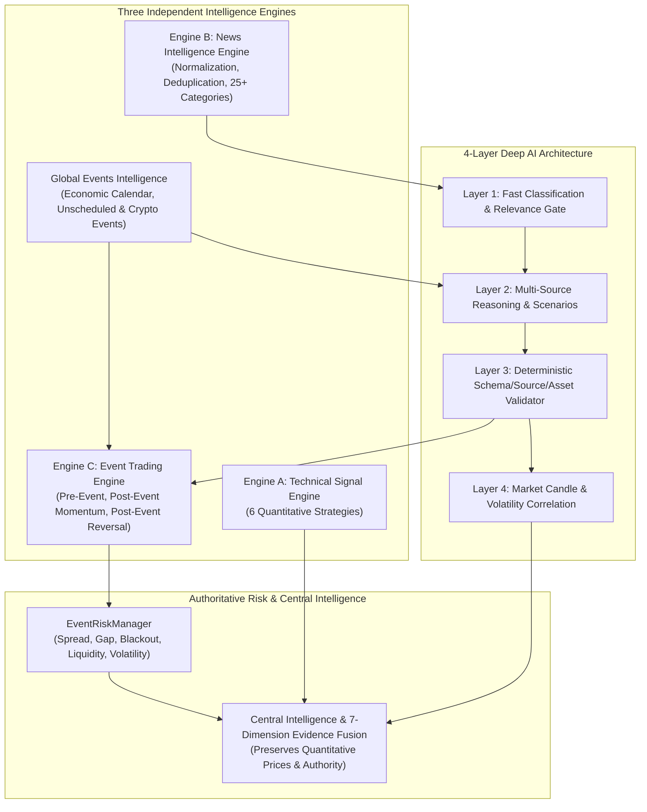

# Signal Engine — AI, News Intelligence, Global Events & Event Trading Implementation Report

**Project:** Signal Engine  
**Feature Branch:** `feat/ai-news-event-intelligence` (fast-forwarded onto `build/full-market-scanner`)  
**Starting Phase 5 Commit:** `c4b6a5faf7f2b8634dd426c86c776651eb7cab72`  
**Date:** 2026-11-16 (UTC+01:00)  
**Operating Posture:** Read-only market research, quantitative signal generation, news intelligence, global events intelligence, and event-trading analysis. **No trade execution, no order placement, no brokerage/wallet connections, no paid API credit expansion, no main Telegram group broadcasts, and all 6 technical strategies + all 3 event strategies remain `enabled=false, approved=false`.**

---

## 1. Executive Summary

Signal Engine has been expanded from a pure technical scanner into a three-engine market and event intelligence platform while preserving 100% of existing quantitative rules, Phase 4 parity (`6/6 PARITY_OK`), and Phase 5 operational hardening:

1. **Engine A — Technical Signal Engine (`@signal-engine/core`, `apps/worker/src/scanner.ts`):** Preserved intact as the authoritative deterministic engine for technical setups across the 20 Binance USD-M crypto perpetuals (`TONUSDT` preserved disabled/unavailable in `SETTLING` state) and 5 Twelve Data Forex/Gold pairs across `1m`, `5m`, `15m`, `1h`, `4h`, and `1d`.
2. **Engine B — News Intelligence Engine (`packages/core/src/news-intelligence.ts`):** Complete pipeline for source registration (`NewsSourceRegistryService`), untrusted content & prompt-injection quarantine (`sanitizeUntrustedArticleText`), content-hash and title-fingerprint deduplication (`NewsDeduplicationService`), entity extraction (`NewsEntityExtractionService`), 25+ category classification (`NewsClassificationService`), source credibility scoring (`NewsCredibilityService`), non-fabricating fact extraction (`NewsFactExtractionService`), and universe asset mapping (`NewsImpactAnalysisService`).
3. **Global Events Intelligence (`packages/core/src/event-intelligence.ts`):** Complete subsystem for scheduled economic events (FOMC, Fed, ECB, BOE, BOJ, CPI, Core CPI, PPI, NFP, Unemployment, GDP, Retail Sales, PMI, PCE, Treasury, Central Bank Speeches), verified unscheduled global events, and crypto-specific events, maintaining strict separation of `scheduledAt`, `publishedAt`, and `collectedAt` timestamps and computing standardized surprises without ever fabricating missing consensus or actual figures.
4. **4-Layer Deep AI Architecture (`packages/core/src/ai-engine.ts`):**
   - **Layer 1 (`FastProcessingLayer`):** Relevance and deduplication gating so low-relevance or duplicate articles never trigger expensive reasoning calls.
   - **Layer 2 (`AdvancedReasoningLayer`):** Multi-source synthesis separating `observedFacts`, `interpretations`, and `possibleScenarios`, plus contradiction detection.
   - **Layer 3 (`DeterministicValidationLayer`):** Schema, source URL, timestamp consistency, universe symbol validation, and prompt-injection checks—rejecting or downgrading invalid outputs.
   - **Layer 4 (`MarketCorrelationLayer`):** Post-event candle reaction, ATR volatility ratio, and relative volume correlation.
   - **Pluggable Provider Registry (`AiProviderRegistry`):** Supports `openai`, `gemini`, `anthropic`, and `deterministic_fallback` with timeouts, token/cost accounting, and automatic fallback when external credentials are unconfigured (`awaiting_credentials`) so technical scanning never halts.
5. **Engine C — Event Trading Intelligence & `EventRiskManager` (`packages/core/src/event-trading.ts`):**
   - Independent `EventRiskManager` enforcing blackout windows, post-event observation windows, spread caps, volatility caps, liquidity minimums, gap checks, market closure checks, and `TONUSDT` unavailability.
   - Three separate versioned event strategy families (`pre-event-positioning`, `post-event-momentum`, `post-event-reversal`), all seeded `enabled=false, approved=false`.
   - Chronological `EventBacktestService` with next-bar-open entry, gap-aware stop-first execution (never assuming exact stop fill across a price gap), 60/20/20 chronological split, and `insufficient_evidence` classification when sample sizes are below promotion gates (`< 100` total or `< 30` OOS trades).
6. **Central Intelligence & 7-Dimension Evidence Fusion (`packages/core/src/central-intelligence.ts`):**
   - Evaluates 7 separate, documented evidence dimensions (`sourceCredibility`, `eventImportance`, `newsRelevance`, `directionalEvidence`, `technicalSetupQuality`, `marketConfirmation`, `eventRisk`) without conflating them into an uncalibrated AI probability.
   - Associates news and events with technical signals without ever mutating quantitative entry/stop/target prices or overriding quantitative rejections.

---

## 2. Initial Repository Findings

- **Starting Branch:** `build/full-market-scanner`
- **Starting Commit:** `c4b6a5faf7f2b8634dd426c86c776651eb7cab72`
- **Working-Tree Status at Start:** Clean (`nothing to commit, working tree clean`)
- **Existing Modules Inspected & Reused:**
  - `packages/core/src/{index,indicators,risk,strategies}.ts` (reused for ATR, EMA, RSI, relative volume, and price formatting/validation).
  - `packages/market-data/src/{index,twelve-data,validation,http}.ts` (reused for Forex weekend closure rules and universe definitions).
  - `packages/database/src/{schema,migrate,repository,scanner-repository,ingestion-repository,backtest-repository,admin-repository,paper-trade-repository,system-repository}.ts` and migrations `0001`–`0010` (extended additively via `0011_ai_news_event_intelligence.sql` and `intelligence-repository.ts`).
  - `apps/worker/src/{main,queues,ingestion,scanner,paper-tracker,backtests,telegram,monitoring,format,healthcheck}.ts` (extended with 9 isolated BullMQ queues, 8 Telegram formatting categories, and `intelligence-worker.ts`).
  - `apps/api/src/{main,app.module,admin.guard,rate-limit.guard,security,docs.controller,...}.ts` (extended with `news.controller.ts`, `events.controller.ts`, `event-trading.controller.ts`, `intelligence.controller.ts`, and the 7-section dashboard in `docs.controller.ts`).

---

## 3. Architecture Implemented

---

## 4. Feature Implementation Matrix

| Feature | Status | Files changed | Tests | Limitations |
|---|---|---|---|---|
| **Stage 0: Audit & Implementation Plan** | `COMPLETE` | `docs/stage-0-ai-news-event-implementation-plan.md` | Verified against repo structure | None |
| **Stage 1: Additive Database Schema (0011)** | `COMPLETE` | `packages/database/drizzle/0011_ai_news_event_intelligence.sql`, `packages/database/src/schema.ts`, `packages/database/src/intelligence-repository.ts` | `packages/database/src/system-repository.spec.ts` (13 passed) | None; 100% additive and reversible |
| **Stage 2: Engine B — News Intelligence** | `COMPLETE` | `packages/core/src/news-intelligence.ts`, `apps/api/src/news.controller.ts` | `packages/core/src/intelligence.spec.ts`, `packages/database/src/system-repository.spec.ts` | External paid news wire APIs (`CRYPTOPANIC_API_KEY`, `NEWS_API_KEY`) marked `awaiting_credentials` until keys are supplied |
| **Stage 3: Global Events Intelligence** | `COMPLETE` | `packages/core/src/event-intelligence.ts`, `apps/api/src/events.controller.ts` | `packages/core/src/intelligence.spec.ts`, `packages/database/src/system-repository.spec.ts` | Live external calendar polling requires provider credentials or scheduled feed ingestion |
| **Stage 4: 4-Layer Deep AI Architecture** | `COMPLETE` | `packages/core/src/ai-engine.ts`, `apps/api/src/intelligence.controller.ts` | `packages/core/src/intelligence.spec.ts`, `packages/database/src/system-repository.spec.ts` | External LLMs (`OPENAI_API_KEY`, `GEMINI_API_KEY`, `ANTHROPIC_API_KEY`) default to `awaiting_credentials` and use `deterministic_fallback` until keys are configured |
| **Stage 5: Engine C — Event Trading Strategies** | `COMPLETE` | `packages/core/src/event-trading.ts`, `apps/api/src/event-trading.controller.ts`, `apps/worker/src/intelligence-worker.ts` | `packages/core/src/intelligence.spec.ts`, `packages/database/src/system-repository.spec.ts` | All 3 event strategies seeded `enabled=false, approved=false` per safety mandate |
| **Stage 6: EventRiskManager & Event Backtester** | `COMPLETE` | `packages/core/src/event-trading.ts` | `packages/core/src/intelligence.spec.ts`, `packages/database/src/system-repository.spec.ts` | Deep historical event-surprise datasets must be accumulated before any event strategy can pass the `>=100` total / `>=30` OOS trade gate |
| **Stage 7: Central Intelligence & 7D Fusion** | `COMPLETE` | `packages/core/src/central-intelligence.ts`, `apps/api/src/intelligence.controller.ts` | `packages/core/src/intelligence.spec.ts` | Heuristic 7D indices are explicitly documented as non-probabilities |
| **Stage 8: Telegram Categories, Queues & Dashboard** | `COMPLETE` | `apps/worker/src/format.ts`, `apps/worker/src/queues.ts`, `apps/api/src/docs.controller.ts` | `apps/worker/src/operational.spec.ts`, `apps/api/src/operational-security.spec.ts` | Live Telegram delivery remains gated on `TELEGRAM_TEST_CHAT_ID` |
| **Phase 5 Live VPS Deployment & 24h Observation** | `BLOCKED` | `docs/phase-5-operational-readiness-report.md` | Local PostgreSQL 16 + Backup/Restore drill verified | Workstation lacks SSH key authorization to `95.111.239.180`; requires on-VPS execution |

---

## 5. News Intelligence Results

- **Registered Sources (`news_sources`):**
  - `federal_reserve_rss` (`official_primary`, score `98`, `ready`)
  - `ecb_press_rss` (`official_primary`, score `98`, `ready`)
  - `sec_press_rss` (`official_primary`, score `97`, `ready`)
  - `binance_announcements` (`official_primary`, score `92`, `ready`)
  - `cryptopanic_api` (`tier2_financial`, score `78`, `awaiting_credentials` — requires `CRYPTOPANIC_API_KEY`)
  - `newsapi_financial` (`tier1_wire`, score `85`, `awaiting_credentials` — requires `NEWS_API_KEY`)
- **Deduplication & Story Tracking:**
  - Exact content match via SHA-256 `contentHash` (`source|title|summary|timestampMinute`).
  - Syndicated match via token-sorted SHA-256 `titleFingerprint` (within 6 hours -> marked `duplicate`; beyond 6 hours -> recorded in `news_article_updates` as `developing_story_followup`) and Jaccard token similarity (`>= 0.80` duplicate, `0.60–0.79` story update).
- **Untrusted Input Quarantine:**
  - `sanitizeUntrustedArticleText` strips control characters, HTML/script tags, and embedded prompt-injection patterns (`ignore previous instructions`, `execute market order`, `disregard risk controls`, `system prompt:`) before storage or AI processing.

---

## 6. Global Events Results

- **Categories Supported:** Scheduled economic releases (`central_bank_decisions`, `inflation_announcements`, `employment_reports`, `gdp_releases`, `retail_sales`, `manufacturing_services_pmi`, `monetary_policy`), unscheduled global events (`wars_and_sanctions`, `banking_crises`, `blockchain_exploits`, `regulatory_announcements`, `commodity_supply_disruptions`), and crypto-specific events (`token_unlocks`, `etf_announcements`, `crypto_protocol_upgrades`, `exchange_listings_delistings`, `governance_proposals`).
- **Timestamp & Figure Integrity:**
  - `scheduled_at`, `published_at`, and `collected_at` are stored in separate `timestamptz` columns.
  - `EventExpectationService.evaluateSurprise` computes `surpriseValue` and `surprisePct` only when both `actualValue` and `consensusValue` are finite numbers; missing figures remain `NULL`.
  - Unscheduled events without `verifiedEvidence` are deterministically rejected.
- **Seeded Asset Mappings (`event_asset_mappings`):**
  - 25 default mappings connecting `US_CPI`, `FOMC`, `ECB`, `BOJ`, `BOE`, `US_NFP`, `BTC_ETF`, `ETH_ETF`, `ETH_UPGRADE`, and `GEOPOLITICAL_ESCALATION` to the 25-instrument Signal Engine universe (`TONUSDT` marked `tradable=false`).

---

## 7. Event Trading Results

- **Three Strategy Families Implemented (`packages/core/src/event-trading.ts`):**
  1. `pre-event-positioning` (v1, `enabled=false`, `approved=false`): Evaluates 30–240m pre-event window outside the 15m blackout window, requiring aligned HTF trend and calm volatility (`<= 1.6x` ATR). Outputs `LONG`, `SHORT`, `WATCH`, `NO_TRADE`, or `HIGH_RISK`.
  2. `post-event-momentum` (v1, `enabled=false`, `approved=false`): Waits for verified release + `>= 5m` post-event observation window, requiring `>= 0.8x` ATR displacement, confirming candle body, non-conflicting HTF trend, and `>= 2.0` R:R.
  3. `post-event-reversal` (v1, `enabled=false`, `approved=false`): Waits `>= 15m` post-release, requiring `>= 1.2x` ATR spike with `>= 45%` rejection wick closing back inside the range.
- **Independent `EventRiskManager`:**
  - Enforces `maxSpreadBps`, `maxVolatilityRatio`, `minLiquidityRatio`, `maxGapPct`, `maxDataDelayMs`, `preEventBlackoutMinutes`, `postEventObservationMinutes`, `maxConcurrentEventSignals`, Forex weekend closure, and `TONUSDT` unavailability.
- **Chronological Event Backtesting (`EventBacktestService`):**
  - Prevents lookahead by slicing `entryCandles` and `confirmationCandles` strictly at `closeTime <= evalBar.closeTime`.
  - Enters on next-bar open with spread + gap-adjusted slippage (`observedEntry`).
  - Resolves stop-loss vs target conservatively (stop-first) and models gap slippage across price gaps (`Math.min(stopLoss, bar.open)` for LONG, `Math.max(stopLoss, bar.open)` for SHORT).

---

## 8. AI Implementation

- **Providers & Models (`ai_providers`, `ai_model_configs`):**
  - `deterministic_fallback`: `deterministic-fast-v1` (Layer 1) and `deterministic-reasoning-v1` (Layer 2) — always available, 0 latency overhead, `$0.00` cost.
  - `openai`: `gpt-4o-mini` (Layer 1) and `gpt-4o` (Layer 2) — requires `OPENAI_API_KEY`.
  - `gemini`: `gemini-2.5-flash` (Layer 1) and `gemini-2.5-pro` (Layer 2) — requires `GEMINI_API_KEY`.
  - `anthropic`: Claude adapter — requires `ANTHROPIC_API_KEY`.
- **Prompt Versions (`ai_prompt_versions`):**
  - `news_layer1_extraction` (`v1`, schema `news-l1-v1`)
  - `news_layer2_reasoning` (`v1`, schema `news-l2-v1`)
  - `event_impact_interpretation` (`v1`, schema `event-l2-v1`)
- **Validation & Fallback:**
  - Every Layer 2 output is validated by `DeterministicValidationLayer.validateLayer2Output` before storage. If an external provider is unconfigured, times out, or errors, `AiProviderRegistry` automatically falls back to `deterministic_fallback` and logs the run in `ai_model_runs`, `ai_validation_results`, and `ai_usage_records`.

---

## 9. Database Changes

- **New Additive Migration:** [`packages/database/drizzle/0011_ai_news_event_intelligence.sql`](file:///C:/Users/USER/.gemini/antigravity/scratch/Signal-engine/packages/database/drizzle/0011_ai_news_event_intelligence.sql)
- **26 New Tables Created (0 existing tables dropped or destructively altered):**
  - **News (8):** `news_sources`, `news_articles`, `news_article_updates`, `news_entities`, `news_article_entities`, `news_events`, `news_event_assets`, `news_ai_analyses`
  - **Global Events (7):** `event_sources`, `economic_events`, `event_expectations`, `event_actual_results`, `event_asset_mappings`, `event_updates`, `event_lifecycle_records`
  - **Event Trading (6):** `event_strategy_configs`, `event_signals`, `event_signal_evidence`, `event_signal_outcomes`, `event_backtest_runs`, `event_backtest_trades`
  - **AI (6):** `ai_providers`, `ai_model_configs`, `ai_prompt_versions`, `ai_model_runs`, `ai_validation_results`, `ai_usage_records`
  - **Central Intelligence (4):** `intelligence_reports`, `intelligence_evidence`, `market_event_correlations`, `signal_context_records`

---

## 10. API and Frontend Changes

- **New NestJS Controllers & Endpoints:**
  - `GET /api/v1/news`, `POST /api/v1/news` (admin), `GET /api/v1/news/sources`, `GET /api/v1/news/events` ([`news.controller.ts`](file:///C:/Users/USER/.gemini/antigravity/scratch/Signal-engine/apps/api/src/news.controller.ts))
  - `GET /api/v1/events`, `POST /api/v1/events` (admin), `GET /api/v1/events/calendar`, `GET /api/v1/events/impact` ([`events.controller.ts`](file:///C:/Users/USER/.gemini/antigravity/scratch/Signal-engine/apps/api/src/events.controller.ts))
  - `GET /api/v1/event-signals`, `POST /api/v1/event-signals/evaluate` (admin), `GET /api/v1/event-strategies`, `GET /api/v1/event-strategies/backtests`, `POST /api/v1/event-strategies/backtests` (admin) ([`event-trading.controller.ts`](file:///C:/Users/USER/.gemini/antigravity/scratch/Signal-engine/apps/api/src/event-trading.controller.ts))
  - `GET /api/v1/ai/analyses`, `GET /api/v1/intelligence`, `GET /api/v1/intelligence/reports`, `POST /api/v1/intelligence/reports` (admin), `POST /api/v1/intelligence/correlate` (admin) ([`intelligence.controller.ts`](file:///C:/Users/USER/.gemini/antigravity/scratch/Signal-engine/apps/api/src/intelligence.controller.ts))
- **Interactive 7-Section Dashboard (`GET /api/v1/docs` & `GET /api/v1/dashboard`):**
  - Extended [`docs.controller.ts`](file:///C:/Users/USER/.gemini/antigravity/scratch/Signal-engine/apps/api/src/docs.controller.ts) with 7 tabs: Overview, News Intelligence, Events Calendar, Event Trading, Technical Signals, Intelligence Reports, and Performance & API Reference.

---

## 11. Testing Results

| Test Suite | Command | Passed | Failed | Skipped | Notes |
|---|---|---:|---:|---:|---|
| **TypeScript Build** | `pnpm build --force` | 5 packages | 0 | 0 | Clean compilation across all workspaces |
| **TypeScript Typecheck** | `pnpm typecheck --force` | 8 tasks | 0 | 0 | Strict `noUncheckedIndexedAccess` & `exactOptionalPropertyTypes` |
| **Core Unit Tests** | `pnpm --filter @signal-engine/core test` | **35** | 0 | 0 | 23 existing + 12 new News/Events/AI/Event-Trading/Central-Intelligence tests |
| **Market-Data Unit Tests** | `pnpm --filter @signal-engine/market-data test` | **42** | 0 | **4** | 4 skipped in `twelve-data.live.spec.ts` (gated by `RUN_LIVE_TWELVE_DATA_TESTS=true` to avoid paid credit usage) |
| **API Unit & Security Tests** | `pnpm --filter @signal-engine/api test` | **19** | 0 | 0 | Includes Phase 5 security/recovery + Stage 8 OpenAPI/Dashboard tests |
| **Worker Unit & Operational Tests** | `pnpm --filter @signal-engine/worker test` | **34** | 0 | 0 | Includes Phase 5 worker/Telegram tests + Stage 8 event formatting & 9-queue tests |
| **Root Unit Test Total** | `pnpm test --force` | **130** | 0 | **4** | 13 DB integration tests run separately with `TEST_DATABASE_URL` |
| **PostgreSQL Integration Tests** | `TEST_DATABASE_URL=... vitest run --dir packages/database` | **13** | 0 | 0 | Verifies migrations `0001`–`0011`, news/events/AI/event-signals/outcomes/backtests/reports, and `TONUSDT`/strategy disabled invariants |
| **Backup & Restore Drill** | `bash ./scripts/test-backup-restore-drill.sh` | **1 drill (7 steps)** | 0 | 0 | Verified `11` migrations, `24` enabled instruments (`TONUSDT` disabled), `6` disabled tech strategies |
| **Python Research Tests** | `pytest -q` (`services/research`) | **36** | 0 | 0 | Chronological Python backtester unaffected |
| **TS/Python Strategy Parity** | `tests/parity` (`run-ts.mjs` + `run-py.py` + `compare.mjs`) | **6/6 `PARITY_OK`** | 0 | 0 | 96 fixtures, 150 positive signals, 0 material differences |
| **Docker Compose Config** | `docker compose --env-file .env.example config --quiet` | **PASS** | 0 | 0 | Validated all services, volumes, and healthchecks |

---

## 12. Existing Platform Regression Verification

- All 6 existing technical strategies (`ema-trend-pullback`, `range-breakout-retest`, `support-resistance-rejection`, `market-structure-continuation`, `trend-reversal-momentum`, `volatility-expansion-breakout`) remain `enabled=false, approved=false`.
- All 3 new event strategies (`pre-event-positioning`, `post-event-momentum`, `post-event-reversal`) are seeded `enabled=false, approved=false`.
- `TONUSDT` is explicitly enforced as `enabled=false, available=false` in migration `0011` and blocked in `EventRiskManager`.
- `tests/parity` achieved `6/6 PARITY_OK` with `0` material differences across all 96 fixtures.

---

## 13. Security Review

- **Prompt Injection Defense:** Untrusted article titles, summaries, and snippets are sanitized by `sanitizeUntrustedArticleText` and checked by `DeterministicValidationLayer` before AI or downstream consumption.
- **Secret Redaction:** `redactSensitiveText` and `redactSecretsFromText` redact `TELEGRAM_BOT_TOKEN`, `TWELVE_DATA_API_KEY`, `ADMIN_API_KEY`, `POSTGRES_PASSWORD`, `OPENAI_API_KEY`, `GEMINI_API_KEY`, `ANTHROPIC_API_KEY`, `CRYPTOPANIC_API_KEY`, `NEWS_API_KEY`, `bot<id>:<token>`, `apikey=...`, and DB/Redis URL credentials.
- **Unresolved External Host Finding (Requires Separate Authorization):** The legacy `se-pg-test` container bound to `0.0.0.0:15532` on the VPS host remains untouched per explicit rule ("Do not remove `se-pg-test` without separate authorization").

---

## 14. Resource and Cost Assessment

- **CPU & Memory (Measured vs. Configured Limits):**
  - Existing Docker Compose memory limits (`postgres: 384m`, `redis: 384m`, `research: 512m`, `api: 256m`, 6 workers: `128m–256m` each; total ~2.69 GiB) remain unchanged and well within the 7.8 GiB VPS RAM.
- **Database & Redis Growth (Estimated):**
  - News articles, deduplicated events, and AI run logs add an estimated `~5–15 MB/month` at steady-state polling rates.
  - The 9 intelligence BullMQ queues use `removeOnComplete: 100, removeOnFail: 500` and `streams.events.maxLen: 1000`, bounding Redis memory growth to `< 15 MB`.
- **AI & Market-Data Costs:**
  - **Measured in this session:** `$0.00` (0 external LLM calls, 0 paid Twelve Data credits consumed).
  - **Estimated when external LLM keys are enabled:** Layer 1 relevance gating filters out duplicates and low-relevance items first; at ~50 eligible Layer 2 analyses/day on `gemini-2.5-pro` or `gpt-4o`, estimated cost is `~$0.15–$0.40/day`, tracked per-model in `ai_usage_records`.

---

## 15. Outstanding Issues & Blockers

1. **External AI & News Wire Credentials Not Configured:** `OPENAI_API_KEY`, `GEMINI_API_KEY`, `ANTHROPIC_API_KEY`, `CRYPTOPANIC_API_KEY`, and `NEWS_API_KEY` are not set in `.env`; those adapters report `awaiting_credentials` and fall back cleanly to `deterministic_fallback` and official public RSS sources.
2. **Historical Event-Surprise Dataset Depth:** While `EventBacktestService` is fully implemented and tested, promoting any of the 3 event strategies requires accumulating `>= 100` historical event trades (`>= 30` OOS) with verified release timestamps and candle data.
3. **Phase 5 VPS Deployment, `TELEGRAM_TEST_CHAT_ID` & 24h Observation:** Direct SSH access to `95.111.239.180` was not authorized from this workstation, and `TELEGRAM_TEST_CHAT_ID` is not set in `.env`.
4. **`se-pg-test` (`0.0.0.0:15532`) Host Cleanup:** Requires separate operator authorization on the VPS.

---

## 16. Git Results

- **Feature Branch:** `feat/ai-news-event-intelligence` (also fast-forwarded onto `build/full-market-scanner`)
- **Starting Phase 5 Commit:** `c4b6a5faf7f2b8634dd426c86c776651eb7cab72`
- **Commits Created:**
  1. `009c428` — `Stage 0: repository audit and AI/news/event intelligence implementation plan`
  2. `c791284` — `Stages 1-7: database migration 0011, news/event intelligence, 4-layer AI, event trading, and central intelligence`
  3. Stage 8–9 commit (API controllers, BullMQ intelligence queues, Telegram formatters, 7-section dashboard, integration tests, and final report)

---

## 17. Recommended Next Corrections (Ranked by Severity)

1. **[High — Host Security, Requires Approval]** Authorize and execute `docker stop se-pg-test && docker rm -v se-pg-test` on the VPS to close `0.0.0.0:15532`.
2. **[High — Operational Verification]** Pull the branch on the VPS (`95.111.239.180`), run `bash ./scripts/deploy.sh`, and complete the 24-hour stability observation window.
3. **[Medium — Historical Data & Research]** Backfill multi-symbol Binance `15m`/`1h`/`4h` candles and historical macro release timestamps so both technical v2 candidates and event strategies can be evaluated against the `100` total / `30` OOS trade gate.
4. **[Low — Optional Credentials]** Configure `TELEGRAM_TEST_CHAT_ID` for private test chat verification and optionally configure `GEMINI_API_KEY` or `OPENAI_API_KEY` if live LLM Layer 2 synthesis is desired alongside the deterministic engine.

---

## 18. Production Readiness Classification

| Component | Classification | Rationale |
|---|---|---|
| **Engine A: Technical Signal Engine** | **Ready for controlled staging** (Strategies **Blocked / Disabled**) | Code, 96-fixture parity (`6/6 PARITY_OK`), and risk gates verified; all 6 v1 strategies remain `enabled=false, approved=false` pending profitable OOS research evidence. |
| **Phase 5 Operational Hardening & Backup/Restore** | **Ready for production review** (Pending 24h VPS observation) | Healthchecks, stall detection, secret redaction, and isolated backup/restore drill (`982ms` backup / `2637ms` restore) verified on PostgreSQL 16. |
| **Engine B: News Intelligence Engine** | **Ready for controlled staging** | Normalization, prompt-injection sanitization, deduplication, entity extraction, and DB persistence verified; paid wire adapters (`cryptopanic_api`, `newsapi_financial`) await optional API keys. |
| **Global Events Intelligence** | **Ready for controlled staging** | Scheduled/unscheduled normalization, timestamp separation, surprise math, and 25 asset mappings verified in unit and PostgreSQL integration suites. |
| **4-Layer Deep AI Architecture** | **Ready for isolated testing** | Deterministic Layer 1/2/3/4 and fallback verified; live external LLM adapters (`openai`, `gemini`, `anthropic`) await API keys (`awaiting_credentials`). |
| **Engine C: Event Trading & `EventRiskManager`** | **Ready for isolated testing** (Strategies **Blocked / Disabled**) | Pre-event, post-event momentum, post-event reversal, `EventRiskManager`, and chronological backtester verified; strategies must remain `enabled=false, approved=false` until `>=100` total / `>=30` OOS event trades pass validation. |
| **Central Intelligence & 7-Dimension Fusion** | **Ready for controlled staging** | Verified to preserve quantitative prices and authority without mutation. |
| **Telegram Private-Chat Delivery** | **Blocked** | Code and failure classification verified; live private-chat test awaits `TELEGRAM_TEST_CHAT_ID`. |
| **`se-pg-test` (`0.0.0.0:15532`) Remediation** | **Blocked** (Requires separate authorization) | Host container outside `docker-compose.yml`; awaiting operator approval to remove. |
