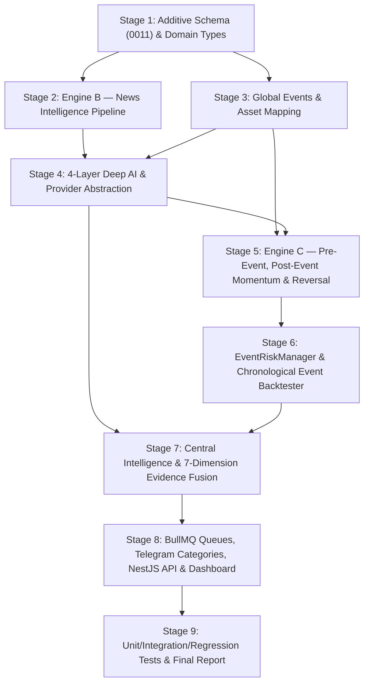

# Stage 0 — Repository Audit, Dependency Map & Staged Implementation Plan

**Project:** Signal Engine — AI, News, Global Events & Event Trading Expansion  
**Starting Branch:** `build/full-market-scanner`  
**Starting Commit:** `c4b6a5faf7f2b8634dd426c86c776651eb7cab72`  
**Feature Branch:** `feat/ai-news-event-intelligence`  
**Date:** 2026-11-16 (UTC+01:00)

---

## 1. Repository Audit Summary

### Existing Modules Inspected & Reused
1. **`packages/core` (`@signal-engine/core`):**
   - Existing modules: `indicators.ts`, `risk.ts`, `strategies.ts`, `index.ts`.
   - Status: Authoritative deterministic Technical Signal Engine (Engine A) with 6 strategy families and `6/6 PARITY_OK` across 96 fixtures. Preserved without modification to technical signal rules or thresholds.
2. **`packages/market-data` (`@signal-engine/market-data`):**
   - Existing modules: `index.ts` (`BinanceUsdMProvider`), `twelve-data.ts` (`TwelveDataProvider`), `validation.ts`, `http.ts`.
   - Status: Read-only market data for 20 Binance USD-M crypto perpetuals (`TONUSDT` disabled/unavailable in `SETTLING`) and 5 Twelve Data Forex/Gold symbols (`EUR_USD`, `GBP_USD`, `USD_JPY`, `EUR_JPY`, `XAU_USD`).
3. **`packages/database` (`@signal-engine/database`):**
   - Existing modules: `schema.ts`, `migrate.ts`, `repository.ts`, `scanner-repository.ts`, `ingestion-repository.ts`, `backtest-repository.ts`, `admin-repository.ts`, `paper-trade-repository.ts`, `system-repository.ts`, `health-repository.ts`, and SQL migrations `0001`–`0010`.
   - Status: Reused and extended via additive migration `0011_ai_news_event_intelligence.sql` and `intelligence-repository.ts`.
4. **`apps/worker` (`@signal-engine/worker`):**
   - Existing modules: `main.ts`, `queues.ts`, `ingestion.ts`, `scanner.ts`, `paper-tracker.ts`, `backtests.ts`, `telegram.ts`, `monitoring.ts`, `format.ts`, `healthcheck.ts`.
   - Status: Extended with isolated BullMQ queues for news, events, AI reasoning, event trading, and intelligence reporting (`intelligence-worker.ts`) so technical scanning never depends on AI or news queues.
5. **`apps/api` (`@signal-engine/api`):**
   - Existing modules: `main.ts`, `app.module.ts`, `admin.guard.ts`, `rate-limit.guard.ts`, `security.ts`, `health.controller.ts`, `signals.controller.ts`, `instruments.controller.ts`, `strategies.controller.ts`, `backtests.controller.ts`, `paper-trades.controller.ts`, `system.controller.ts`, `docs.controller.ts`.
   - Status: Extended with `news.controller.ts`, `events.controller.ts`, `event-trading.controller.ts`, `intelligence.controller.ts`, and an interactive Market & Event Intelligence Dashboard at `/api/v1/docs` (`/api/v1/dashboard`).
6. **`services/research`:**
   - Existing Python FastAPI chronological backtester (`36 passed` in `pytest`). Preserved intact.

### What Exists vs. What Is Added

| Capability | Pre-Existing State | New Implementation |
|---|---|---|
| Engine A: Technical Signal Engine | Complete (6 strategies, disabled/unapproved) | Preserved unchanged; enriched via non-intrusive `signal_context_records` |
| Engine B: News Intelligence Engine | Missing | Pluggable adapters, normalization, prompt-injection sanitization, deduplication, entity extraction, 25+ categories, credibility scoring, fact & impact analysis |
| Global Events Intelligence | Missing | Economic calendar, unscheduled & crypto events, separate scheduled/published/collected timestamps, surprise calculation, configurable asset mappings |
| Multi-Layer Deep AI Architecture | Missing | Layer 1 (fast), Layer 2 (reasoning), Layer 3 (deterministic validation), Layer 4 (market correlation), provider abstraction, cost/token tracking, safe fallback |
| Engine C: Event Trading Engine | Missing | `pre-event-positioning`, `post-event-momentum`, `post-event-reversal` (all seeded `enabled=false, approved=false`), `EventRiskManager`, chronological event backtester |
| Central Intelligence & Signal Fusion | Missing | 7-dimension evidence model, cross-engine fusion, conflict detection, event-risk flagging without overriding quantitative prices or validation |
| Telegram & Dashboard | Technical signal & alert templates; static API table | 8 notification categories with private-chat guards; 7-section interactive Market & Event Intelligence Dashboard |

---

## 2. Dependency Map & Staged Execution Plan

